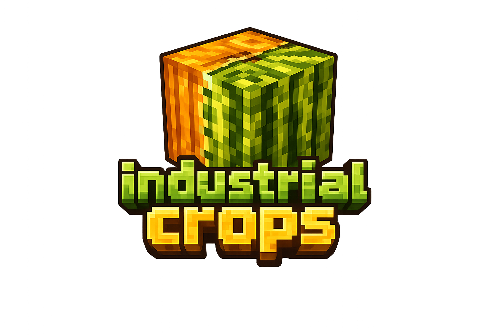

<p align="center">
  
</p>

# Industrial Crops · 尖端工业化农作物

从一块农田开始，培育工业作物，把收获送入加工生产线，再用物流网络连接储存与能源设备。Industrial Crops 将农业育种和工业自动化结合起来，让作物成为工厂的一部分。

[下载](https://github.com/Yesaz0erq/Industrial_crops/releases) · [问题反馈](https://github.com/Yesaz0erq/Industrial_crops/issues) · [MIT 许可](LICENSE)

## 从农田到工厂

- **培育作物**：种植工业作物，研究品质与遗传，使用分析和改造设备推进育种。
- **建立生产线**：逐步发展加工、冶炼、生物能源和等离子体设备，进入更高阶段的工业生产。
- **连接设备**：用管道、储存柜和网络终端管理物品与流体，支持远程访问。
- **探索特殊材料**：制作悖钢与稳态物质，使用拟态、数字化和物质复制设备。
- **收集罗贝饰品**：在村庄宝箱中寻找十七种罗贝，获得战斗、探索或生存能力；头盔罗贝可复制部分数值效果或独立防护次数。

二十二个进度里程碑串联农业、工业和罗贝内容。JAR 内包含 **Industrial Crops**、**Carrote（胡罗贝）** 和 **Carrote Curios（胡罗贝饰品）** 三个模块，无需分别下载。

## 下载与安装

| Minecraft | 加载器 | Java | 必需依赖 | 源码 |
| --- | --- | --- | --- | --- |
| 1.21.1 | NeoForge 21.1.227+ | 21 | GeckoLib 4.9+ | [main](https://github.com/Yesaz0erq/Industrial_crops/tree/main) |
| 1.20.1 | Forge 47.4.23（构建版本） | 17 | GeckoLib 4.8+ | [forge-1.20.1](https://github.com/Yesaz0erq/Industrial_crops/tree/forge-1.20.1) |

在 [Releases](https://github.com/Yesaz0erq/Industrial_crops/releases) 中选择对应 Minecraft 与加载器的 JAR，与同版本 GeckoLib 一起放入 `mods` 文件夹。客户端与服务端均需安装。

可选安装 **JEI** 查看配方，或安装 **Curios** 使用饰品栏：NeoForge 版对应 Curios 9.5.1+（9.x），Forge 版对应 Curios 5.14.1+（5.x）。未安装 Curios 时，罗贝仍可通过主手或副手生效；头盔罗贝装备在头盔栏。按住 Shift 查看饰品使用说明。

## C1 源码同步

版本保持 **1.0-C1**。本次补回正在使用的新版内容：INV、泰肯、绿色铁矿石与材料，泰肯锻造炉及紫色界面，银黑色 AP 结构钢及八帧反光动画，卫星火箭与发射场、水晶钢信号接收与卫星控制装置，以及 AP 农业和畜牧多方块设备。融合锭使用下界合金锭合成。

新版运行资源已同步到 `src/main/resources`，包括 `assets/industrialcrops/textures/item/inv_ingot.png`。信号接收与卫星控制装置保留回退后的材质。未使用资源已按源码和模型引用清理。

部分新版 Java 源码从本地运行 JAR 恢复，并进行了加载器适配；因此局部变量名可能与最初手写源码不同。

Forge 1.20.1 使用 Java 17，并适配了能量/物品/流体接口、NBT 存档、菜单、实体渲染和配方格式。1.20.1 没有原版合成器，因此对应合成器材料使用工作台替代。

## 从源码构建

本目录是可独立构建的 Forge 1.20.1 工程，使用 Java 17。NeoForge 1.21.1 工程位于仓库的 `main` 分支根目录。每个工程包含源码、运行资源与 Gradle Wrapper。

进入目标工程，使用上表对应的 Java 版本执行：

```sh
# Linux / macOS
./gradlew build
```

```powershell
# Windows
.\gradlew.bat build
```

首次构建需要联网下载依赖。成品位于所选工程的 `build/libs/`。启动开发客户端使用 `runClient`；添加 `-PwithoutCurios=true` 可在不加载 Curios 的情况下运行。

## 反馈与贡献

欢迎通过 [Issues](https://github.com/Yesaz0erq/Industrial_crops/issues) 报告问题或提出建议。报告问题时请提供 Minecraft 版本、加载器与模组版本、复现步骤，以及相关日志或崩溃报告。

项目采用 [MIT 许可](LICENSE)。作者：OFFSET Inc.
